

<a href="https://myfreelab.ru">
  <picture>
    <source media="(prefers-color-scheme: dark)" srcset="assets/banner-dark.png">
    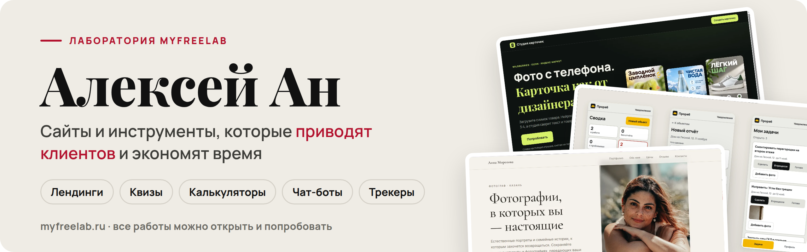
  </picture>
</a>

  
  
  

## Привет, я Алексей 👋

Собираю сайты и инструменты для небольших компаний и частных специалистов: от текста и дизайна до рабочего адреса в интернете. **Все работы ниже живые:** их можно открыть и попробовать так, как это сделает ваш клиент.

- ⚡ Отвечаю в течение дня и объясняю простыми словами.
- 🎓 Учусь и собираю портфолио, поэтому цены ниже рыночных.
- 📱 Каждую страницу проверяю на компьютере и на телефоне.
- 🔐 Домен, HTTPS и уведомления о заявках настраиваю сам.

## 🧭 С чего начнём?

<table>
  <tr>
    <td width="50%" valign="top">
      <h3>🧲 Привлечь клиентов</h3>
      Лендинг, квиз или бот, которые превращают посетителей в заявки. 
      Примеры: <a href="https://quiz.myfreelab.ru">квиз ремонта</a> · <a href="https://robotex.myfreelab.ru">школа робототехники</a>
    </td>
    <td width="50%" valign="top">
      <h3>🧮 Посчитать и продать</h3>
      Калькулятор, смета и КП по вашему прайсу за пару минут. 
      Примеры: <a href="https://calc.myfreelab.ru">смета-калькулятор</a> · <a href="https://kp.myfreelab.ru">КП-генератор</a>
    </td>
  </tr>
  <tr>
    <td width="50%" valign="top">
      <h3>✨ Показать себя</h3>
      Сайт-визитка, который выглядит дорого и ведёт к записи. 
      Примеры: <a href="https://photo.myfreelab.ru">фотограф</a> · <a href="https://club.myfreelab.ru">трейдинг-клуб</a>
    </td>
    <td width="50%" valign="top">
      <h3>📋 Наладить работу</h3>
      Трекеры и кабинеты, где команда и клиенты видят задачи, отчёты и прогресс. 
      Примеры: <a href="https://prorab.myfreelab.ru">Прораб</a> · <a href="https://zachet.myfreelab.ru">Зачёт</a>
    </td>
  </tr>
</table>

## 🔬 Живые проекты

<table>
  <tr>
    <td width="33%" valign="top">
      <a href="https://studio.myfreelab.ru">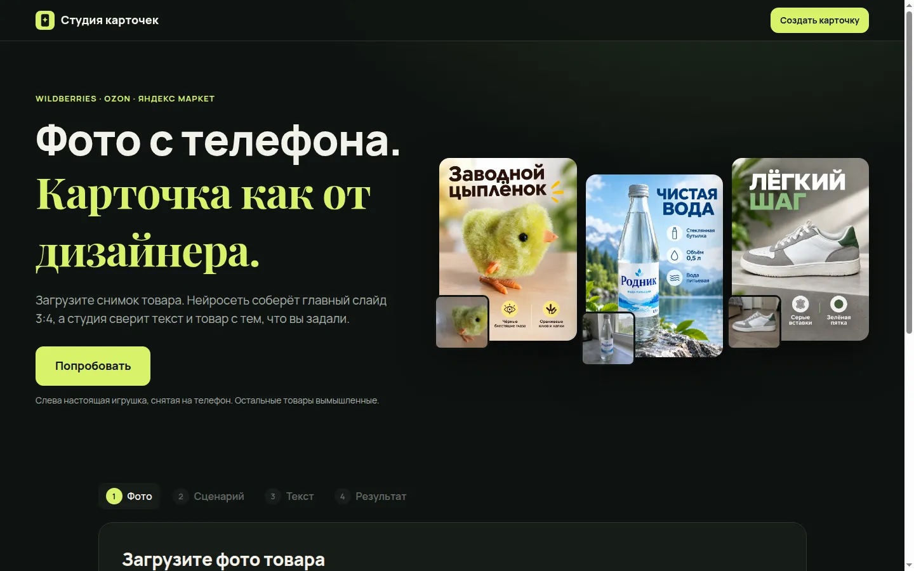</a>
      
<b>Студия карточек</b> Карточки для Wildberries и Ozon по фото товара: форма и цвет сохраняются, текст проверяется заранее.

      FastAPI · React · Docker · GPT Image 
      <a href="https://studio.myfreelab.ru">▶ Открыть</a>
    </td>
    <td width="33%" valign="top">
      <a href="https://prorab.myfreelab.ru">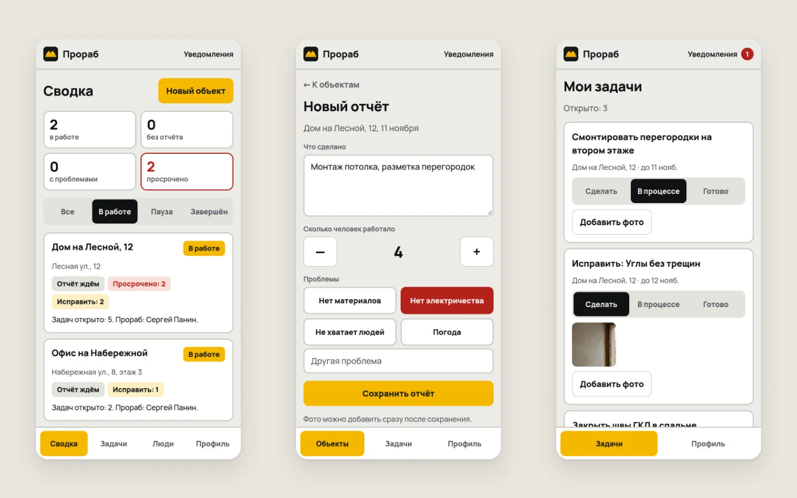</a>
      
<b>Прораб</b> Все объекты стройки на одном экране: отчёты с фото, проблемы и просрочки. Четыре роли, от директора до рабочего.

      Node.js · SQLite · Docker 
      <a href="https://prorab.myfreelab.ru">▶ Открыть</a> · <a href="https://github.com/alex2180369/pulse.myfreelab">Код</a>
    </td>
    <td width="33%" valign="top">
      <a href="https://zachet.myfreelab.ru">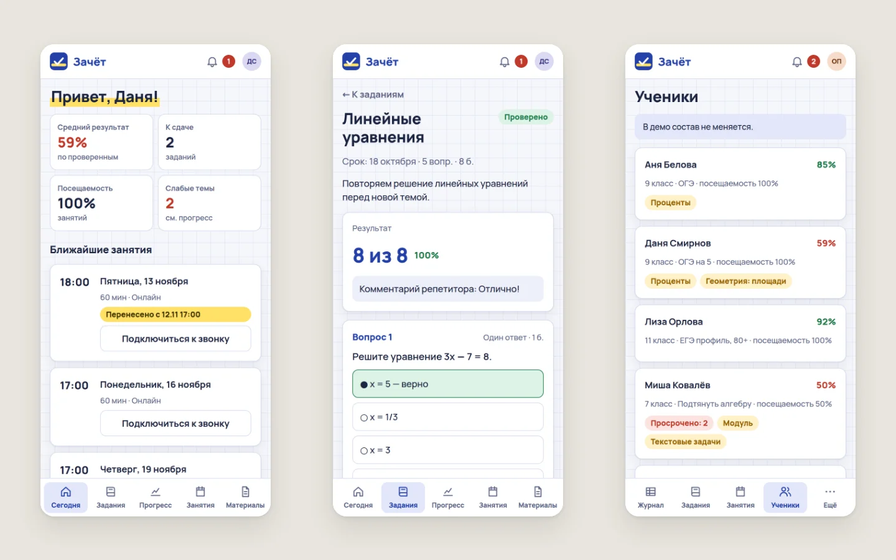</a>
      
<b>Зачёт</b> Домашка с автопроверкой для репетитора и кабинет, где родитель видит прогресс ученика.

      Node.js · SQLite · Web Push 
      <a href="https://zachet.myfreelab.ru">▶ Открыть</a> · <a href="https://github.com/alex2180369/pulse.myfreelab">Код</a>
    </td>
  </tr>
  <tr>
    <td width="33%" valign="top">
      <a href="https://pulse.myfreelab.ru">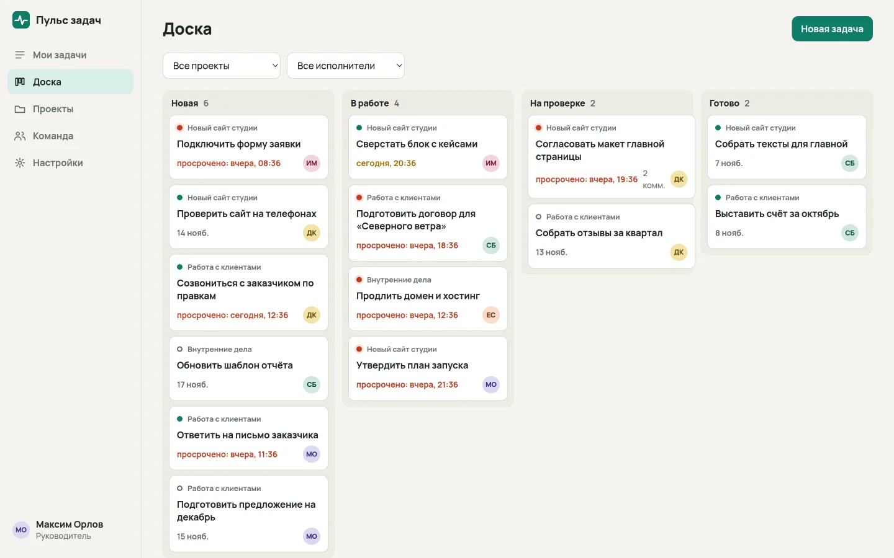</a>
      
<b>Пульс задач</b> Доска задач небольшой команды и Telegram-бот: задачи и статусы прямо в мессенджере.

      Node.js · SQLite · Telegram Bot API 
      <a href="https://pulse.myfreelab.ru">▶ Открыть</a> · <a href="https://github.com/alex2180369/pulse.myfreelab">Код</a>
    </td>
    <td width="33%" valign="top">
      <a href="https://quiz.myfreelab.ru">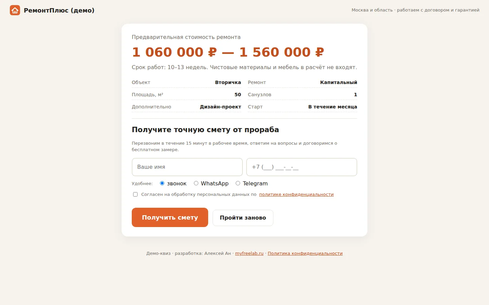</a>
      
<b>Сколько стоит ремонт</b> Квиз с расчётом: клиент заранее видит бюджет, а прораб получает объём работ.

      HTML · JavaScript · Apps Script 
      <a href="https://quiz.myfreelab.ru">▶ Открыть</a>
    </td>
    <td width="33%" valign="top">
      <a href="https://calc.myfreelab.ru">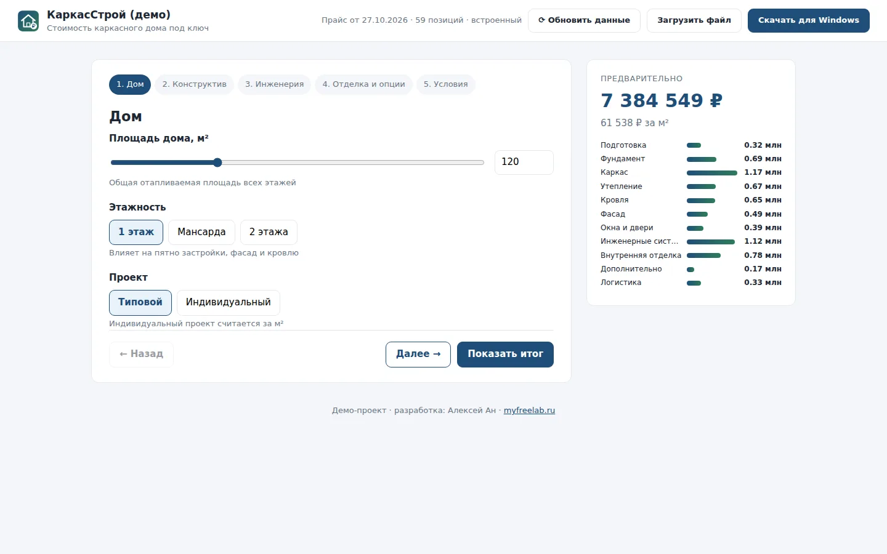</a>
      
<b>Смета-калькулятор</b> Смета и КП на каркасный дом за 2 минуты вместо часа в Excel. Цены компания меняет сама.

      Electron · JavaScript · SheetJS 
      <a href="https://calc.myfreelab.ru">▶ Открыть</a>
    </td>
  </tr>
</table>

<b>Ещё 6 проектов</b>

 
<table>
  <tr>
    <td width="33%" valign="top">
      <a href="https://kp.myfreelab.ru">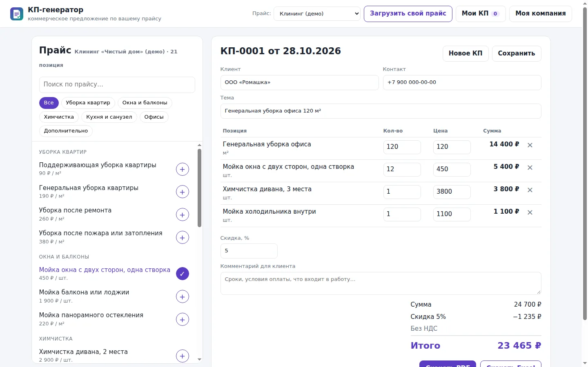</a>
      
<b>КП-генератор</b> Коммерческое предложение из любого прайса за минуту: с логотипом, скидкой и НДС.

      JavaScript · SheetJS · PDF 
      <a href="https://kp.myfreelab.ru">▶ Открыть</a>
    </td>
    <td width="33%" valign="top">
      <a href="https://robotex.myfreelab.ru">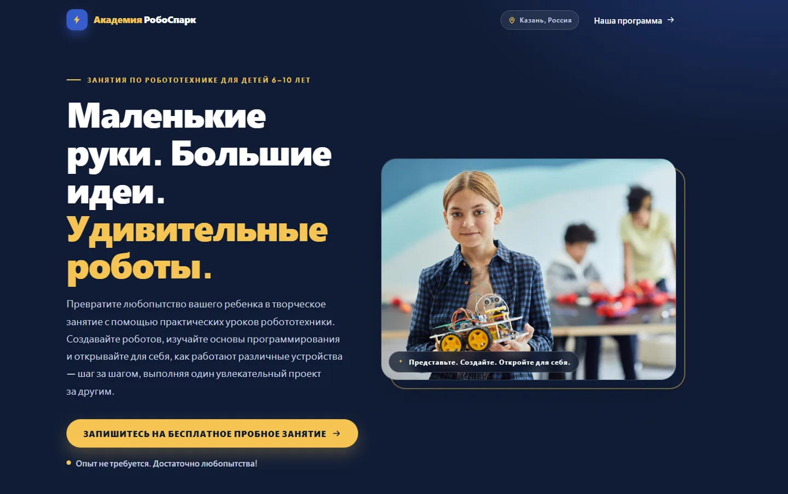</a>
      
<b>Школа робототехники</b> Одна страница, которая ведёт родителя от «что это?» до записи на пробное занятие.

      HTML · CSS · JavaScript 
      <a href="https://robotex.myfreelab.ru">▶ Открыть</a> · <a href="https://github.com/alex2180369/robotex.myfreelab">Код</a>
    </td>
    <td width="33%" valign="top">
      <a href="https://salon.myfreelab.ru">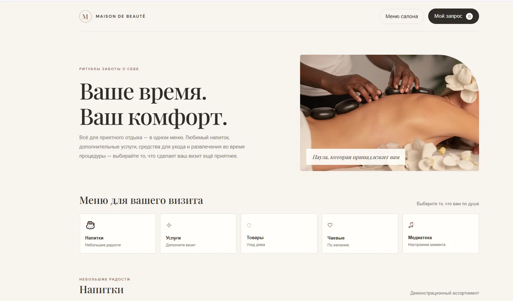</a>
      
<b>Салон красоты</b> Цифровое меню: гость заранее собирает визит, администратор получает готовый запрос.

      HTML · JavaScript · Node.js · SQLite 
      <a href="https://salon.myfreelab.ru">▶ Открыть</a> · <a href="https://github.com/alex2180369/salon.myfreelab">Код</a>
    </td>
  </tr>
  <tr>
    <td width="33%" valign="top">
      <a href="https://psy.myfreelab.ru">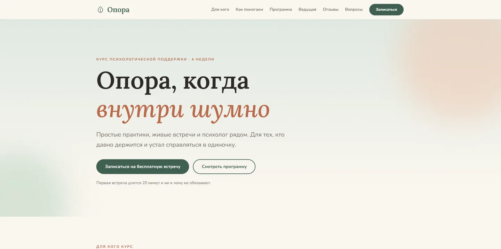</a>
      
<b>Психологическая поддержка</b> Бережный путь к записи на курс: программа, формат и ответы на сомнения.

      HTML · CSS · JavaScript 
      <a href="https://psy.myfreelab.ru">▶ Открыть</a> · <a href="https://github.com/alex2180369/psychology.support.myfreelab">Код</a>
    </td>
    <td width="33%" valign="top">
      <a href="https://photo.myfreelab.ru">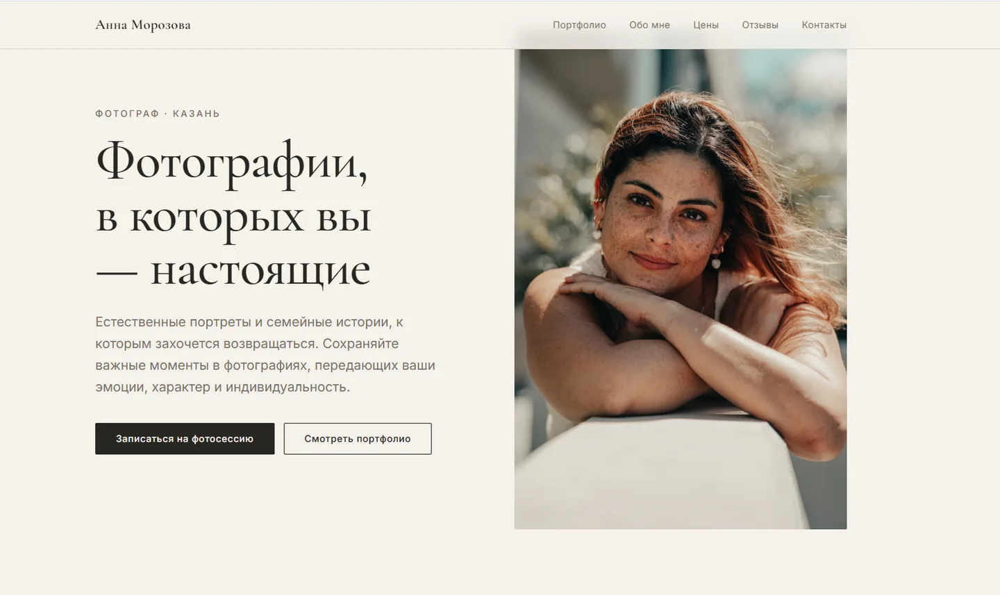</a>
      
<b>Фотограф</b> Портфолио, которое не мешает снимкам и ведёт к записи на съёмку.

      React · Vite · CSS 
      <a href="https://photo.myfreelab.ru">▶ Открыть</a> · <a href="https://github.com/alex2180369/photo.myfreelab">Код</a>
    </td>
    <td width="33%" valign="top">
      <a href="https://club.myfreelab.ru">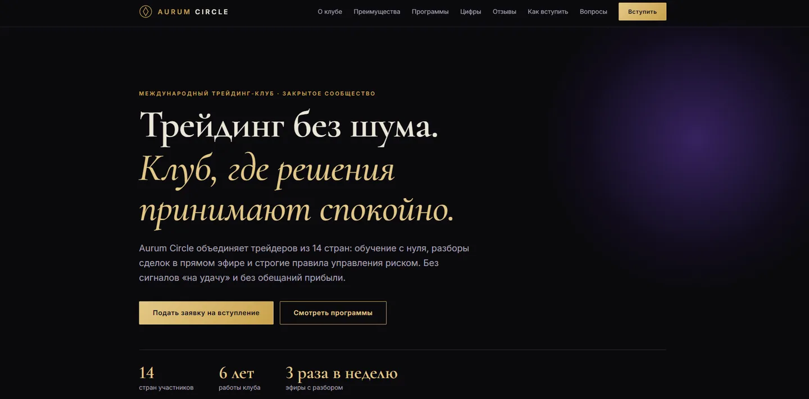</a>
      
<b>Трейдинг-клуб</b> Сайт клуба в стиле «старые деньги»: доверие и заявка на вступление без лишних шагов.

      HTML · CSS · JavaScript 
      <a href="https://club.myfreelab.ru">▶ Открыть</a> · <a href="https://github.com/alex2180369/club.myfreelab">Код</a>
    </td>
  </tr>
</table>

## 🛠 Как я работаю

<picture>
  <source media="(prefers-color-scheme: dark)" srcset="assets/process-dark.png">
  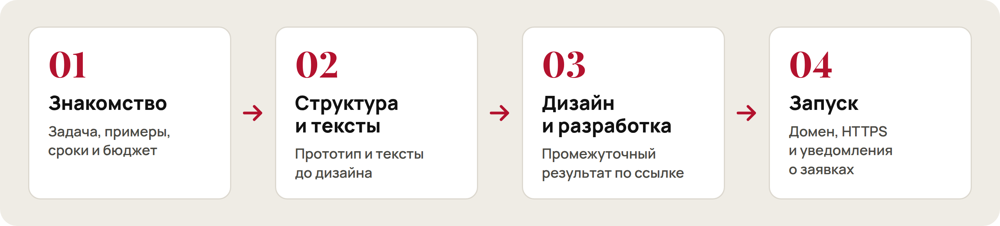
</picture>

Знакомство бесплатно. После запуска передаю доступы и объясняю, как всё устроено.

## 🧰 Инструменты

  
  
  
  
  
  
  
  
  
  
  
  
  
  
  

## 📡 Сейчас

- 🔭 Пять трекеров на одном ядре: [Пульс задач](https://pulse.myfreelab.ru) для команды, [Серия](https://seriya.myfreelab.ru) для привычек, [Прораб](https://prorab.myfreelab.ru) для стройки, [Тонус](https://tonus.myfreelab.ru) для здоровья и [Зачёт](https://zachet.myfreelab.ru) для репетитора. Код в [pulse.myfreelab](https://github.com/alex2180369/pulse.myfreelab).
- 🌱 Учусь на курсе по фрилансу и собираю портфолио из живых проектов.
- 💬 Спросите меня про квизы, калькуляторы по прайсу, Telegram-ботов и трекеры.
- ⚡ Vibe Coder: от идеи до живого адреса с HTTPS.

## 📫 Обсудим задачу?

Расскажите, что нужно сделать, и я отвечу в течение дня. Если задача пока не сформулирована, это нормально: разберёмся вместе.

**Telegram:** [@AlexAn_369](https://t.me/AlexAn_369) · **Почта:** [alex2180369@gmail.com](mailto:alex2180369@gmail.com) · **Сайт:** [myfreelab.ru](https://myfreelab.ru)

🇬🇧 In English

 

Hi, I'm Alex. I build landing pages, quizzes, price calculators, chatbots and team trackers for small companies and independent professionals. Every project above is live: open it and try it the way your customer would. Message me on Telegram: [@AlexAn_369](https://t.me/AlexAn_369).

лаборатория myfreelab · 2026

